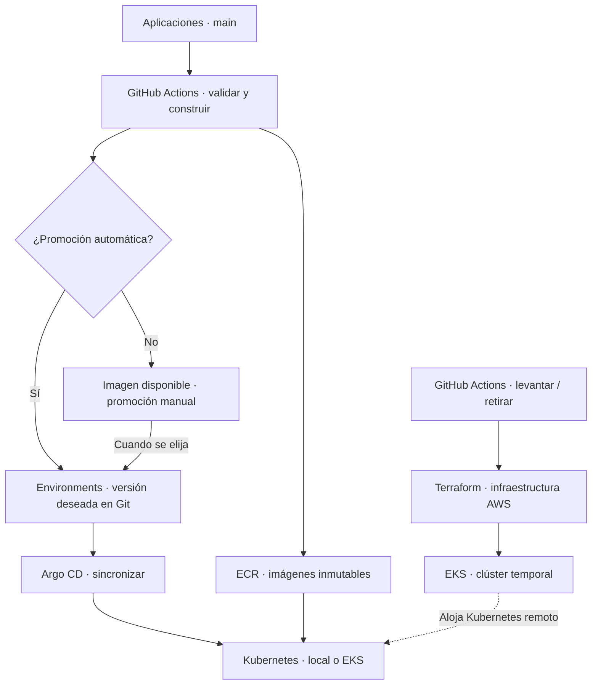

# Plataforma de Paideia Code

**Una base común para ejecutar aplicaciones de distintas tecnologías, con
despliegues controlados y ambientes que podamos retirar y reconstruir.**

Diseño y estado revisados: **8 de noviembre de 2026**. Esta es la entrada actual
del plan; el [diseño inicial](docs/diseno-inicial.md) es un antecedente histórico.

## La idea en un minuto

1. Cada proyecto conserva su código, Dockerfiles y migraciones.
2. GitHub Actions valida el código y construye imágenes identificables.
3. El repositorio de ambientes indica qué versiones queremos desplegar.
4. Argo CD lee esa configuración y la aplica en Kubernetes.
5. Terraform crea la infraestructura AWS sobre la que corre Kubernetes.
6. Un procedimiento externo al clúster permite crearlo y retirarlo cuando queramos.

El diagrama describe el destino. Kubernetes, Argo CD y los workflows todavía
están pendientes. Consulta el [estado comprobado](docs/estado-y-recorrido.md).

## Qué decisión controla cada cosa

| Quiero… | Control previsto |
| --- | --- |
| Integrar código sin desplegarlo | Promoción de esa aplicación en modo manual |
| Desplegar cada cambio válido de `main` | Promoción automática al ambiente elegido |
| Tener el sandbox disponible | Ejecutar `environment-up` |
| Dejar de pagar EKS entre sesiones | Ejecutar `environment-down`, que elimina el clúster |
| Volver a trabajar | Recrear el ambiente y reconciliar las versiones elegidas en Git |
| Conservar datos importantes | Darles un ciclo de vida separado del clúster |

**Estos workflows son nombres previstos; aún no están implementados.**
Un merge no creará un clúster que decidimos mantener retirado.

## Herramientas y responsabilidades

| Herramienta | Responsabilidad |
| --- | --- |
| Terraform | Red, EKS, nodos, ECR, identidades y otros recursos AWS declarados |
| Kubernetes | Ejecutar APIs, workers y trabajos; mantener sus réplicas |
| Helm | Plantillas reutilizables de Kubernetes y sus parámetros |
| Argo CD | Mantener Kubernetes conforme a la configuración seleccionada en Git |
| GitHub Actions | Construcción, promoción de versiones y ciclo de vida del ambiente |
| ECR | Guardar las imágenes que ejecutaremos |

Argo CD se instalará dentro de cada clúster. La automatización para reconstruirlo
vivirá fuera, en GitHub y Terraform. La primera versión usará Argo CD instalado
por nosotros mediante Helm, sin un servidor permanente ni la capacidad
administrada adicional de EKS para Argo CD.

## Alcance de Paideia

Se admiten repositorios con una aplicación y monorepos con varias. La unidad de
despliegue es una aplicación ejecutable. Las plantillas no obligarán a utilizar
Node, Spring ni un Config Server.

| Pilar | Uso de la plataforma |
| --- | --- |
| Theory y sitio | Contenido y GitHub Pages; no requiere EKS |
| POCs y Projects | Ambientes de ejecución cuando estén habilitados |
| Templates | Validación y ejemplos desplegables; sin ambiente permanente obligatorio |
| Libraries | Construcción y publicación de paquetes; sin Kubernetes obligatorio |

La primera vuelta usará **seis templates de Enrollments en Nest, Spring y Go**,
con variantes por capas y hexagonal, almacenamiento en memoria y sin migraciones.
Empezaremos con una aplicación y reutilizaremos lo comprobado en las otras.
[Alcance y organización de los templates](docs/templates-iniciales.md).
Courses y los POCs existentes se conservan como antecedentes y consumidores posteriores.

## Presupuesto y datos

El objetivo es **USD 10–20 mensuales para el laboratorio**, usando sesiones
remotas cortas y práctica local habitual. EKS todo el mes supera ese presupuesto:
solo el plano de control estándar cuesta unos USD 73 por 730 horas.
[Precio de EKS](https://aws.amazon.com/eks/pricing/).

Retirar el sandbox elimina recursos temporales. Estado, imágenes, secretos y
respaldos elegidos permanecen y pueden generar cargos. Los datos descartables
se recrean; los datos valiosos necesitan conservación y recuperación explícitas.
Consulta [costos](docs/costos.md) y [servicios y datos](docs/servicios-y-datos.md).

## Cómo leer sin abrumarse

- **¿Qué hacemos después?** [Estado y recorrido](docs/estado-y-recorrido.md).
- **¿Qué tendrán los seis templates?** [Primera vuelta](docs/templates-iniciales.md).
- **¿Dónde va cada archivo?** [Arquitectura](docs/arquitectura.md).
- **¿Qué hace un merge?** [Despliegues](docs/despliegues.md).
- **¿Cómo encendemos y retiramos?** [Ciclo de vida](docs/ciclo-de-vida.md).
- **¿Qué puedo gastar?** [Costos](docs/costos.md).
- **¿Qué compartimos?** [Servicios y datos](docs/servicios-y-datos.md).
- **¿Por qué lo hacemos así?** [Decisiones](docs/decisiones.md).
- **¿Qué significa una palabra?** [Glosario](docs/glosario.md).
