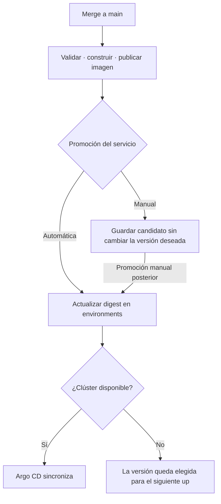

# Pipelines, main y despliegues

[Volver a la vista general](../README.md)

**Construir una versión y decidir desplegarla son acciones distintas.** Podemos
integrar código en `main` sin cambiar una aplicación que está funcionando.

Estado: comportamiento que implementaremos. No hay workflows nuevos operativos
por la sola existencia de este documento.

## Tres pasos, tres resultados

| Paso | Resultado |
| --- | --- |
| Construir | Imagen validada, publicada e identificada por digest |
| Promover | Git de ambientes registra esa imagen como versión elegida |
| Sincronizar | Argo CD aplica lo elegido en el clúster disponible |

No se reconstruirá una imagen al promoverla entre ambientes. Un tag SemVer ayuda
a leer la versión; el digest identifica el contenido. Evitaremos `latest` como
versión de despliegue. La retención de ECR conservará imágenes activas y candidatas
de rollback, no eliminará una imagen solo porque el clúster esté retirado.

## Qué hace main en cada repositorio

| Repositorio | Al integrar en main |
| --- | --- |
| Aplicación | Validar y construir los servicios afectados; promover los configurados en automático |
| Platform | Validar/publicar nuevas versiones de charts y workflows; los consumidores eligen adoptarlas |
| Terraform | Validar módulos y ejemplos; actualizar un módulo no crea recursos por sí mismo |
| Environments | Validar configuración; Argo CD observa las rutas Kubernetes del ambiente activo |

Los cambios de infraestructura producen planes revisables. Su aplicación remota
se coordina mediante workflows específicos y la política de ciclo de vida; no
se ejecuta un `apply` indiscriminado por cualquier cambio de imagen o documentación.

## Comportamiento al cambiar una aplicación

Las imágenes se publican contra la base ECR conservada. Si esa base no está
preparada, el workflow debe explicarlo y fallar; no crear infraestructura costosa
como efecto secundario. Un runner alojado en GitHub no alcanza el Floci local del
usuario mediante `localhost`: automatizar ese laboratorio requeriría un runner
local o un emulador dentro del propio job.

## Dos controles independientes

| Ambiente | Promoción | Resultado de un merge válido |
| --- | --- | --- |
| Levantado | Automática | Se registra la nueva versión y Argo CD la despliega |
| Levantado | Manual | Se publica candidato; continúa la versión anterior |
| Retirado | Automática | Se registra la versión deseada; EKS permanece retirado |
| Retirado | Manual | Se publica candidato; no cambia la versión elegida ni se crea EKS |

Modo manual controla la promoción de imágenes. Un cambio explícito en los
manifiestos/valores de `environments/main` sigue siendo una intención de despliegue
y puede sincronizarse. Para congelar **toda** sincronización existe un control
distinto de Argo CD; no llamaremos a ambas cosas "no desplegar".

El apagado bloqueará reconciliaciones que puedan recrear recursos durante la
limpieza. Desactivar solo un job de GitHub no detiene a Argo CD si modificamos
igualmente sus fuentes observadas.
[Sincronización automática de Argo CD](https://argo-cd.readthedocs.io/en/stable/user-guide/auto_sync/).

## Reutilización y monorepos

Los repositorios consumidores tendrán un workflow pequeño. El trabajo común vive
en `paideia-infra-platform/.github/workflows`, con `workflow_call` e inputs como
contexto de construcción, Dockerfile e identidad de imagen. Java y Node pueden
necesitar comprobaciones diferentes antes de una construcción común.
[Workflows reutilizables](https://docs.github.com/en/actions/how-tos/reuse-automations/reuse-workflows).

En un monorepo un paso calcula qué servicios fueron afectados y prepara una
matriz. Los cambios en dependencias compartidas, padre Maven, Dockerfiles base
y scripts de construcción deben incluir a sus consumidores. Un filtro limitado
a `services/course-service/**` no cubre todos esos casos.

Cada servicio conserva imagen, versión deseada y política de promoción propias.
La primera implementación puede validar todo el monorepo y optimizar después:
no necesitamos detección perfecta de cambios para admitir su estructura.

## Acceso de las automatizaciones

- AWS: GitHub Actions asumirá un rol por OIDC, limitado al repositorio/ambiente
  y a las operaciones necesarias. No usaremos las credenciales `test` de Floci
  ni credenciales AWS permanentes como patrón.
  [OIDC entre GitHub y AWS](https://docs.github.com/en/actions/how-tos/secure-your-work/security-harden-deployments/oidc-in-aws).
- Git entre repositorios: la promoción necesita autorización explícita; el
  `GITHUB_TOKEN` del proyecto no tiene acceso automático de escritura a otro repo.
  Preferiremos una GitHub App con permisos limitados y cambios trazables.
- Dependencias de automatización: fijaremos referencias revisadas de actions,
  workflows, módulos y charts. Cambiar la plataforma no actualizará todos los
  proyectos sin que adopten esa versión.

Las promociones concurrentes de servicios diferentes no deben sobrescribirse.
Su escritura se centraliza o se serializa con reintento contra la versión actual
de Git; un push rechazado no se resuelve forzando la rama.

## Orden de una aplicación con base de datos

Esta sección corresponde a la segunda vuelta. Los seis templates iniciales
usan memoria: se omiten base, secretos de base y migración, y se despliega la API
con una réplica. [Alcance inicial](templates-iniciales.md).

1. Namespace, configuración y secretos disponibles.
2. Dependencia de datos creada/restaurada y lista.
3. Job de migración completado con salida cero.
4. Deployment de la aplicación y comprobaciones de readiness.
5. Validación HTTP y de negocio.

Argo CD ofrece fases y waves para ordenar recursos. Una migración `PreSync`
no puede asumir que PostgreSQL, creado después en `Sync`, ya existe: elegiremos
el orden y las esperas según ese caso. Al incorporar persistencia se probará la
creación desde una base vacía y desde una base ya migrada.
[Fases y waves](https://argo-cd.readthedocs.io/en/stable/user-guide/sync-waves/).

`depends_on` de Terraform ordena recursos Terraform; no demuestra que un Job
haya completado una migración. Los Jobs terminados no son servicios que deban
mantener réplicas. El pipeline no promoverá una aplicación con migración fallida.

## Actualizar y volver atrás

Registrar el digest nuevo en Git permite a Argo CD actualizar la aplicación.
Volver al digest anterior también se expresa mediante Git, conservando el historial.
Un rollback imperativo aislado puede ser deshecho por la sincronización posterior.

Revertir una imagen no revierte las tablas. Las migraciones deben conservar la
compatibilidad necesaria durante el cambio de versión; una modificación de datos
destructiva requiere un procedimiento propio de respaldo y recuperación.

## Cuándo consideraremos terminado este flujo

- Un merge automático actualiza solo las aplicaciones habilitadas/afectadas.
- Un merge en modo manual conserva su versión en ejecución.
- Con el sandbox retirado, ningún merge vuelve a crear EKS.
- La promoción deja rastro del commit de origen, digest y destino.
- La versión elegida puede desplegarse después de reconstruir el clúster.
- Los errores de construcción, migración y sincronización se muestran por separado.
