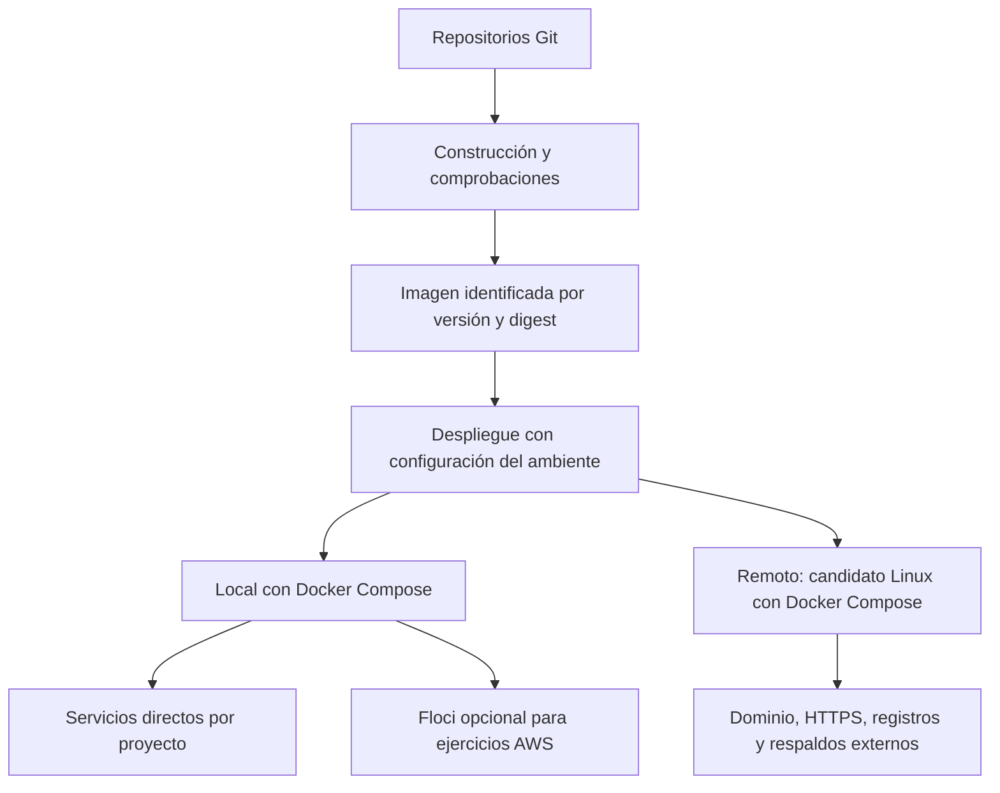
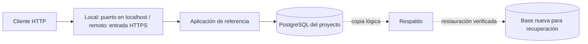

# Diseño inicial de la plataforma

> **Antecedente histórico del 5 de noviembre de 2026.** La arquitectura vigente
> está en la [vista general actual](../README.md). Las opciones de servidor con
> Compose y el laboratorio de referencia descritos aquí pertenecen a esa etapa;
> sus rutas retiradas no son instrucciones de operación actuales. Esta página
> no confirma que esas prácticas o archivos sigan disponibles.

Estado: propuesta de trabajo v0.1 con primer laboratorio local implementado,
5 de noviembre de 2026.

## 1. Objetivo y alcance

Facilitar que los proyectos de Paideia Code puedan construirse, ejecutarse,
observarse y recuperarse con procedimientos comunes y comprensibles.

La plataforma crecerá para incorporar sitios, APIs, trabajadores de segundo plano,
tareas programadas y otros tipos de software. Las aplicaciones móviles y de
escritorio podrán aprovechar automatización, distribución de artefactos y servicios
backend; su ejecución en los dispositivos tendrá necesidades propias. GPU,
hardware especial y otros requisitos se evaluarán cuando aparezcan.

Reutilizar significa compartir convenciones, módulos y procedimientos. Cada
proyecto conserva la propiedad de su aplicación, configuración y datos.

## 2. Tres opciones de ejecución

| Opción | Qué ejecuta | Para qué se usa |
| --- | --- | --- |
| Local con servicios directos | Aplicación y, cuando corresponda, PostgreSQL u otros servicios en contenedores | Aprender fundamentos y desarrollar software sin depender de APIs de nube |
| Local con Floci | Aplicación y servicios AWS emulados, creados mediante configuración específica | Estudiar integraciones AWS y practicar infraestructura como código |
| Remota | Aplicación y dependencias en una máquina Linux o servicios de un proveedor por seleccionar | Publicar proyectos y aprender operación con acceso real por red |

Las dos opciones locales son complementarias. Un proyecto que usa SQS necesita
ese contrato de servicio; sustituir SQS por otra cola requiere adaptar la
integración. Cambiar PostgreSQL directo por una instancia gestionada también
requiere revisar conexiones y operación. La plataforma documentará estas
diferencias en lugar de prometer intercambiabilidad automática.

Floci se presenta como un emulador local de servicios AWS para desarrollo y CI.
La compatibilidad de cada integración deberá comprobarse con la versión utilizada.
Un ejercicio local no demuestra equivalencia de permisos, disponibilidad,
rendimiento o costos en AWS real.

## 3. Arquitectura de referencia

Una imagen es un paquete ejecutable de la aplicación y sus dependencias. Un
contenedor es una instancia en ejecución de esa imagen. Compose describe cómo
conectar contenedores, redes y volúmenes de un despliegue. Un volumen conserva
datos fuera del contenedor; su persistencia no reemplaza un respaldo.

El primer ejercicio tendrá este recorrido de petición:

La base remota propuesta es un solo servidor para simplificar el aprendizaje y
la operación inicial. Docker documenta Compose para despliegues en un servidor.
Esta opción comparte capacidad y fallos del host; no ofrece alta disponibilidad.
Se revisará antes de alojar servicios que necesiten continuidad mayor.

## 4. Responsabilidades y aislamiento

| Plataforma | Proyecto consumidor |
| --- | --- |
| Convenciones de nombres, ambientes y configuración | Código de la aplicación y su configuración particular |
| Patrones de red, acceso y despliegue | Dependencias y permisos requeridos |
| Procedimientos de registros, respaldo y recuperación | Migraciones y validación de los datos de negocio |
| Componentes reutilizables con versiones documentadas | Versiones de plataforma adoptadas y necesidades de actualización |

Cada despliegue se identifica por proyecto y ambiente, por ejemplo
`reference-local`. Tendrá redes, volúmenes y credenciales propios. Una red Docker
común permite comunicación y debe crearse únicamente cuando sea necesaria.
Compartir el mismo motor Docker no equivale a aislamiento fuerte entre usuarios
o cargas no confiables.

En local se publicarán puertos en `127.0.0.1` por defecto. La base se accederá por
la red del proyecto; el acceso desde herramientas del host se habilitará
explícitamente cuando haga falta. En remoto, la entrada pública propuesta será
HTTP/HTTPS mediante un proxy inverso, con administración restringida.

El código y la configuración de ejemplo van a Git. Las credenciales reales,
estados con información sensible y respaldos permanecen fuera del repositorio.
Los estados de Terraform de local y nube serán independientes. El destino de
respaldos y la gestión de secretos remotos se definirán antes de publicar.

## 5. Cómo incorporamos Floci

La POC AWS existente ya separa el Compose de Floci del Compose de aplicaciones y
crea recursos locales con Terraform. Usaremos esa experiencia como antecedente.
El diseño de la plataforma todavía no cambia esa POC.

Para una futura implementación común:

1. Floci será una capacidad opcional, con versión de imagen fijada y requisitos
   de Docker documentados.
2. Cada laboratorio tendrá recursos y estado de infraestructura identificables.
   Si comparte una instancia de Floci, sus nombres deberán evitar colisiones y
   se documentará el impacto de reiniciar o borrar esa instancia.
3. Los endpoints y las credenciales de emulación se configurarán explícitamente.
   El perfil local no utilizará credenciales reales de AWS ni hará fallback
   silencioso a endpoints remotos.
4. Se distinguirán direcciones del host y direcciones dentro de contenedores.
   `localhost` dentro de un contenedor identifica a ese contenedor; otros
   servicios se alcanzan por sus nombres en una red compartida.
5. El acceso al socket Docker, utilizado por la POC para servicios respaldados
   por contenedores, se tratará como acceso privilegiado al motor del laboratorio.

## 6. Recorrido de la aplicación

1. **Preparar:** seleccionar una aplicación HTTP pequeña con PostgreSQL y
   documentar sus variables, puertos, migraciones y comprobaciones de salud.
2. **Construir:** generar una imagen identificable y registrar su versión.
   La construcción inicial será local; después se automatizará en CI.
3. **Desplegar:** preparar configuración, iniciar dependencias, ejecutar las
   migraciones y arrancar la aplicación. Una dependencia disponible y una
   aplicación lista para atender tráfico son comprobaciones diferentes.
4. **Comprobar:** realizar una petición que escriba y otra que lea un dato.
   Un endpoint de salud por sí solo no valida el recorrido completo.
5. **Operar:** consultar registros, limitar su crecimiento y diagnosticar una
   dependencia detenida.
6. **Actualizar:** desplegar una segunda versión y comprobar su comportamiento.
   Volver a la imagen anterior requiere compatibilidad con el esquema de datos;
   revertir una imagen no revierte una migración.
7. **Recuperar:** generar un respaldo y restaurarlo en una base nueva. Verificar
   los datos mediante la aplicación y registrar tiempo y resultado.

## 7. Entregas y aprendizaje

| Entrega | Resultado verificable | Conceptos |
| --- | --- | --- |
| 1. Referencia local | Aplicación y PostgreSQL arrancan desde instrucciones repetibles; un dato sobrevive a recrear el contenedor | Procesos, imágenes, puertos, DNS interno, redes y volúmenes |
| 2. Operación local | Se diagnostica una dependencia detenida y se restaura un respaldo en un entorno separado | Salud, registros, persistencia y recuperación |
| 3. Variante AWS local | Un ejercicio publica y consume un mensaje mediante servicios emulados en Floci | APIs AWS, endpoints, Terraform, estado y mensajería |
| 4. Segunda aplicación | Se reutilizan piezas del primer despliegue con datos y configuración independientes | Límites de los módulos y reutilización comprobada |
| 5. Publicación remota | Aplicación accesible con HTTPS, acceso administrativo restringido y restauración documentada | Linux, DNS, TLS, permisos y costos |
| 6. Automatización | Una versión concreta se construye, publica y despliega mediante un procedimiento automatizado | CI/CD, artefactos y trazabilidad |

La entrega 3 puede aprovechar la POC AWS existente. Las diferencias necesarias
para incorporarla se revisarán antes de modificarla. Cada entrega tendrá una
explicación, una práctica y evidencia del resultado; escribir documentación no
demuestra que la práctica se haya realizado.

## 8. Presupuesto y evolución

La preferencia expresada es comenzar también en local y considerar un gasto
remoto de hasta US$10–20 mensuales. Es un límite de diseño orientativo, no una
cotización ni un límite técnico de facturación.

Antes de elegir proveedor se calculará el conjunto: cómputo, disco, respaldos,
transferencia, direcciones públicas, dominio e impuestos aplicables. Se definirá
si el dominio queda dentro del presupuesto. Las alertas avisan; no garantizan
que el gasto se detenga. El uso local consume recursos del equipo y electricidad.

La primera publicación buscará una configuración pequeña dentro del presupuesto
verificado. Los servicios gestionados y sus costos se evaluarán por separado.
Una máquina remota con Compose y AWS emulado localmente son alternativas con
objetivos distintos; trasladar una POC a AWS real exigirá su propio diseño.

Kubernetes, alta disponibilidad, gestión centralizada de secretos y observabilidad
avanzada tendrán ejercicios propios cuando exista una necesidad operativa o un
objetivo de estudio definido. La separación entre laboratorio experimental y
servicios habituales se concretará antes de alojar ambos remotamente.

## 9. Primera implementación y decisiones pendientes

Se eligió Courses, una aplicación NestJS existente con PostgreSQL y migraciones.
El laboratorio de referencia de esa etapa (`labs/reference-local`, ruta retirada) la construye
desde su repositorio, con imágenes propias, puerto 18080 y un proyecto Compose
independiente de la POC AWS. La elección permite aprovechar una aplicación real
sin convertir su framework en requisito de la plataforma.

Se verificaron escritura y lectura HTTP, persistencia al recrear contenedores y
restauración en otro proyecto Compose con red y volumen propios. Esta ejecución
es evidencia técnica del laboratorio; el recorrido personal de aprendizaje
permanece pendiente de realizar por el estudiante.

Pendientes:

- Practicar el diagnóstico de una dependencia detenida y explicar el recorrido local.
- Fijar la imagen base Node del build y versionar la configuración con su código fuente de referencia antes de distribuir una versión estable.
- Proveedor, región, tamaño de servidor y desglose del costo remoto.
- Dominio, registro de imágenes y herramienta de automatización.
- Frecuencia y retención de respaldos, pérdida de datos tolerable y tiempo de recuperación.

El siguiente paso de aprendizaje es inspeccionar los componentes del laboratorio
y distinguir estado del proceso, conectividad con PostgreSQL y persistencia.

## Fuentes oficiales

- [Docker: Compose en un servidor](https://docs.docker.com/compose/how-tos/production/).
- [Docker: redes de Compose](https://docs.docker.com/compose/how-tos/networking/).
- [Floci: repositorio y documentación](https://github.com/floci-io/floci).
- [PostgreSQL: respaldo y recuperación](https://www.postgresql.org/docs/current/backup.html).
- [HashiCorp: composición de módulos](https://developer.hashicorp.com/terraform/language/modules/develop/composition).
- [CNCF: madurez de plataformas](https://tag-app-delivery.cncf.io/whitepapers/platform-eng-maturity-model/).
